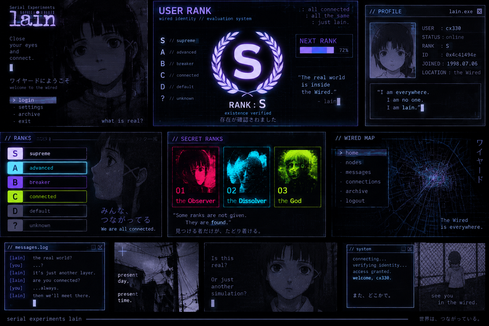

<div align="center">


<br/>

<p align="center">
  <a href="https://github.com/xploitoverload">
    
  </a>
  <a href="https://linkedin.com/in/kalpesh11111">
    
  </a>
  <a href="https://instagram.com/_kalpesh.solanki_">
    
  </a>
  <a href="mailto:skalpesh942@gmail.com">
    
  </a>
  <a href="https://leetcode.com/xploitoverload/">
    
  </a>
  <a href="https://github.com/xploitoverload/upstream-contributions-tracker">
    
  </a>
</p>

# <p align="center"> [𝓗𝓮𝓵𝓵𝓸 ^_^](#-%F0%9D%93%97%F0%9D%93%AE%F0%9D%93%B5%F0%9D%93%B5%F0%9D%93%B8-_-) </p>

<p align="center">
   <code>𝚝𝚘 𝚖𝚢 𝙶𝚒𝚝𝙷𝚞𝚋 𝚙𝚛𝚘𝚏𝚒𝚕𝚎</code>
</p>

<p align="center">
  
</p>

</div>

<br/>

<h2>
  <font color="#e50914" size="6">#</font> 
  A̵̺̼̠̫͚͙͎͇͛̈́͑̌b̸̛̮̗̺͉̰̃͌́̏̑̇͋͝͝ò̴̡̪͖̻̱̫͇̪̍͘ų̵͚͙͉̳̱̯̳̩͚͑̋̌̂͛̽̍̌̒̕ẗ̵͖͔̳̜̬̝̝͉̪ ̸̻̦̣͓̪͉̳͖̜̺̉̔̓͌͂͌͛̎́ṃ̷̏̾̓ē̸͇͖̳̲͆̽̾̎̈́̊ 
  
</h2>

<div align="center">
  
</div>

<br/>

```c
/* Ring 0 Linux Kernel Security Researcher & The Star */
static const struct security_researcher kalpesh = {
    .handle        = "xploitoverload",
    .alias         = "CX330 (The Star)",
    .real_name     = "Kalpesh Solanki",
    .privilege     = RING_0_SUPERVISOR,
    .roles         = { "Linux Kernel Security", "Advanced Red Teaming", "Exploit Development", "Vulnerability Research" },
    .cve_track     = { "CVE-2026-97601", "8 Upstream Kernel Contributions" },
    .subsystems    = { "netdev", "rtw88", "bonding", "tun/tap", "ieee802154", "mctp" },
    .offensive_kit = { "BloodHound", "Impacket", "Havoc/Sliver", "Ligolo-ng", "Hell's Gate", "Ghidra/GDB" },
    .philosophy    = "Audit the seams. Hunt the races. Quiet dominance. Outshine the galaxy."
};
```

<br/>

<h2><font color="#e50914" size="6">#</font> 🌌 The CX330 Chronicles & Research Field Notes</h2>

> 🌟 *"CX330 is the most isolated young star that has been discovered in the universe."* — **NASA**  
>  
> *"True power needs no noise. Solitude breeds focus, and intense isolation allows a state of pure flow. Operating alone in the dark, dismantling obstacles with surgical precision, and outshining galaxies."*

<div align="center">

| Research Track | Focus Areas & Technical Deep Dives | Key Methodologies & Artifacts |
| :--- | :--- | :--- |
| **💥 Binary Exploitation & Pwn** | Stack Buffer Overflows on Linux x86, format string exploits, ROP chain synthesis, shellcoding | `THM Pwn101`, `HTB Stack Overflows`, `PicoCTF Pwn Series (Pwn106)` |
| **🔐 Applied Cryptography for Muggles** | Chinese Remainder Theorem (CRT), Fermat's Little Theorem, Extended Euclidean Algorithm, Discrete Math | `密碼學任督二脈`, `Modular Arithmetic Inverses`, `RSA & Stream Ciphers` |
| **⚡ Low-Level Systems & Hardware** | CPU registers, x86/ARM stack frames, Calling Conventions, Byte Code vs. Assembly vs. Machine Code | `CPU Register Internals`, `Kernel MMIO`, `Disassembly Walkthroughs` |
| **🎯 Weaponized Tooling & Web Pwn** | Advanced SQLMap automation, automated fuzzing heuristics, UAPI boundary inspection | `SQLMap Weaponized Spellbook`, `Automated Injection Protocols` |
| **🚩 HackTheBox & CTF Vault** | Comprehensive machine exploitation, cryptographic challenge breakdowns, privilege escalation | `BabyEncryption`, `Time Capsule`, `Insomnia`, `Locked Away`, `Racecar` |

</div>

<br/>

<h2><font color="#e50914" size="6">#</font> Upstream Kernel Contributions</h2>

<div align="center">

[](https://git.kernel.org)
[](https://git.kernel.org/netdev/net/c/968f2b94a596)
[](https://github.com/xploitoverload/upstream-contributions-tracker)
[](CONTRIBUTING.md)

</div>

> 🌟 **[👉 Click here to explore the full Upstream Contributions Portfolio & Technical Case Studies in CONTRIBUTING.md](CONTRIBUTING.md)**  
> 📋 *Or click the **Contributing** tab in the repository navigation bar to view full patch breakdowns, senior maintainer endorsements, and vulnerability analyses.*  
> 🧠 **[👉 Read the Ring 0 Systems & Kernel Interview Playbook](https://github.com/xploitoverload/upstream-contributions-tracker/blob/main/INTERVIEW_PREP_RING0.md)**

```
┌────────────────────────────────────────────────────────────────────────────────────────┐
│                        UPSTREAM LINUX KERNEL & SYSTEMS TRACK RECORD                    │
├───────────────────┬─────────────────────────────────────────────────┬──────────────────┤
│ Category          │ Scope & Subsystems                              │ Status           │
├───────────────────┼─────────────────────────────────────────────────┼──────────────────┤
│ Kernel Security   │ netdev, tun, ieee802154 (CVE-2026-97601)        │ MERGED 🎉        │
│ Wireless Drivers  │ rtw88 (PCIe ASPM DMI Quirk & Recovery Series)   │ COMMITTED / APPR │
│ Core Networking   │ drivers/net/bonding (Link Invariant Guard v2)   │ FORMALLY APPR 🚀 │
│ Protocol Hardening│ drivers/net/tun & net/mctp (SKB Panic On Warn)  │ ACTIVE REVIEW    │
│ Desktop Security  │ xfce4-screensaver (Unlock Bypass & BadWindow)   │ MERGED 🎉        │
└───────────────────┴─────────────────────────────────────────────────┴──────────────────┘
```

> 📌 *Detailed root-cause whitepapers, standalone QEMU reproduction sandboxes, and verification logs are maintained in my [**upstream-contributions-tracker**](https://github.com/xploitoverload/upstream-contributions-tracker).*

<br/>

<h2><font color="#e50914" size="6">#</font> Red Teaming & Advanced Offensive Operations</h2>

<div align="center">

| Domain | Tactical Specialization & Methodologies | Offensive Tooling & Arsenal |
| :--- | :--- | :--- |
| **Active Directory & Identity** | Kerberos exploitation, AD CS abuse, DACL/ACE abuse, Domain Dominance, Token impersonation, Coerced authentication | `BloodHound`, `Impacket`, `Mimikatz`, `Rubeus`, `Certipy`, `PKINITtools`, `NetExec`, `Responder` |
| **C2 & Adversary Emulation** | Command & control infrastructure, covert lateral movement, resilient egress channels, multi-stage beaconing | `Cobalt Strike`, `Havoc C2`, `Sliver`, `Mythic`, `Evil-WinRM`, `WMIExec`, `DCOM` |
| **EDR / AV Evasion & Malware Dev** | User-mode API unhooking, direct & indirect syscalls, memory scanner evasion, shellcode staging, AMSI & ETW patching | `Hell's / Halo's Gate`, `TartarusGate`, `Process Hollowing`, `APC Queue Injection`, `Custom Shellcode Loaders` |
| **Network Pivoting & Infiltration** | Multi-hop internal routing, traffic encapsulation, covert exfiltration, socks proxying | `Ligolo-ng`, `Chisel`, `Proxychains-ng`, `FRP`, `Socat`, `WireGuard Tunnels` |
| **Binary Exploitation & Reversing** | Ring 0/Ring 3 vulnerability research, ROP chain creation, kernel heap spray, disassembly & decompilation | `Ghidra`, `IDA Pro`, `Binary Ninja`, `GDB + GEF/Pwndbg`, `Radare2`, `ROPgadget` |
| **Privilege Escalation (LPE)** | Linux kernel exploitation (UAF, race conditions, dirty-pipe/cow), Windows token manipulation & service hijacking | `CVE-2023-0386`, `Dirty Pipe`, `JuicyPotatoNG`, `GodPotato`, `LinPEAS / WinPEAS` |

</div>

<br/>

<h2><font color="#e50914" size="6">#</font> Ring 0 Systems Domain Expertise</h2>

```
╔═══════════════════════════════════════════════════════════════════════════════════════════════════════╗
║                                LINUX KERNEL & RING 0 DOMAIN EXPERTISE                                 ║
╠══════════════════════════╦════════════════════════════════════════════════════════════════════════════╣
║ Subsystems               ║ netdev, mac80211, cfg80211, rtw88, bonding, tun/tap, ieee802154, mctp      ║
║ Concurrency & Locking    ║ Spinlocks (irqsave), Mutexes, RCU, Lockdep, Memory Barriers, Workqueues    ║
║ Execution Contexts       ║ Atomic Context vs Process Context, Top-Half HardIRQs, Bottom-Half SoftIRQs ║
║ Memory & Hardware        ║ SLUB Allocator, GFP Flags (ATOMIC/KERNEL), DMA Coherency, MMIO, PCIe ASPM  ║
║ Kernel Triage & Tooling  ║ QEMU/KVM + GDB, ftrace, bpftrace, dyndbg, KASAN, UBSAN, Syzbot Repro Triage║
║ Security & Exploitation  ║ User Namespaces (CLONE_NEWUSER), ioctl Auditing, Race Exploits, eBPF       ║
╚══════════════════════════╩════════════════════════════════════════════════════════════════════════════╝
```

<br/>

<h2><font color="#e50914" size="6">#</font> Tech Arsenal & Tools</h2>

<div align="center">

<table>
<tr>
<td align="center" width="33%">

**Systems & Low-Level**<br/><br/>


</td>
<td align="center" width="33%">

**Security & Research**<br/><br/>


</td>
<td align="center" width="33%">

**Software & Frameworks**<br/><br/>


</td>
</tr>
</table>

</div>

<br/>

<h2>
  <font color="#e50914" size="6">#</font> 
   
  Open Source Analytics & 𝚂𝚝𝚊𝚝𝚜 
  
</h2>

<div align="center">

<a href="https://next.ossinsight.io/widgets/official/compose-user-dashboard-stats?user_id=184857390" target="_blank" style="display: block" align="center">
  <picture>
    <source media="(prefers-color-scheme: dark)" srcset="https://next.ossinsight.io/widgets/official/compose-user-dashboard-stats/thumbnail.png?user_id=184857390&image_size=auto&color_scheme=dark" width="770" height="auto">
    
  </picture>
</a>

</div>

<br/>

<h2><font color="#e50914" size="6">#</font> Contribution Activity & Problem Solving</h2>

<div align="center">


<br/><br/>

<table border="0">
<tr>
<td width="50%" align="center">
  <a href="https://streak-stats.demolab.com/?user=xploitoverload">
    
  </a>
</td>
<td width="50%" align="center">
  <a href="https://leetcode.com/xploitoverload/">
    
  </a>
</td>
</tr>
</table>

</div>

<br/>

<h2><font color="#e50914" size="6">#</font> Contribution Matrix</h2>

<div align="center">

<picture>
  <source media="(prefers-color-scheme: dark)" srcset="https://raw.githubusercontent.com/xploitoverload/snk/output/github-contribution-grid-snake-dark.svg">
  
</picture>

</div>

<br/>

<div align="center">

<p align="center">
  
</p>


</div>
