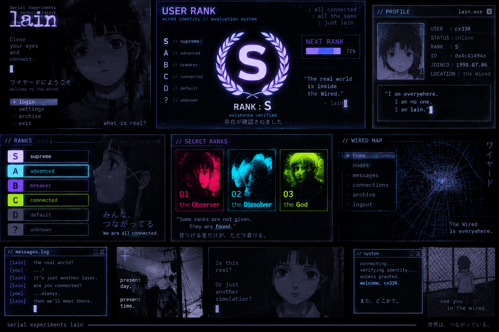

  

# 
 [𝓗𝓮𝓵𝓵𝓸 ^_^](#-%F0%9D%93%97%F0%9D%93%AE%F0%9D%93%B5%F0%9D%93%B5%F0%9D%93%B8-_-) 

 𝚝𝚘 𝚖𝚢 𝙶𝚒𝚝𝙷𝚞𝚋 𝚙𝚛𝚘𝚏𝚒𝚕𝚎
 
## [A̵̺̼̠̫͚͙͎͇͛̈́͑̌b̸̛̮̗̺͉̰̃͌́̏̑̇͋͝͝ò̴̡̪͖̻̱̫͇̪̍͘ų̵͚͙͉̳̱̯̳̩͚͑̋̌̂͛̽̍̌̒̕ẗ̵͖͔̳̜̬̝̝͉̪ ̸̻̦̣͓̪͉̳͖̜̺̉̔̓͌͂͌͛̎́ṃ̷̏̾̓ē̸͇͖̳̲͆̽̾̎̈́̊ ](#a%CC%B5%CD%9B%CD%84%CD%91%CC%8C%CC%BA%CC%BC%CC%A0%CC%AB%CD%9A%CD%99%CD%8E%CD%87b%CC%B8%CC%83%CD%8C%CD%9D%CD%81%CD%9D%CC%8F%CC%91%CC%87%CD%8B%CC%9B%CC%AE%CC%97%CC%BA%CD%89%CC%B0o%CC%B4%CD%80%CD%98%CC%8D%CC%AA%CD%96%CC%A1%CC%BB%CC%B1%CC%AB%CD%87%CC%AAu%CC%B5%CC%95%CD%91%CC%8B%CC%8C%CC%82%CD%9B%CC%BD%CC%8D%CC%8C%CC%92%CD%9A%CD%99%CD%89%CC%B3%CC%A8%CC%B1%CC%AF%CC%B3%CC%A9%CD%9At%CC%B5%CC%88%CD%96%CD%94%CC%B3%CC%9C%CC%AC%CC%9D%CC%9D%CD%89%CC%AA-%CC%B8%CC%89%CC%94%CD%83%CD%8C%CD%82%CD%8C%CD%9B%CC%8E%CD%81%CC%BB%CC%A6%CC%A3%CD%93%CC%AA%CD%89%CC%B3%CD%96%CC%9C%CC%BAm%CC%B7%CC%8F%CC%BE%CD%83%CC%A3e%CC%B8%CC%84%CD%86%CC%BD%CC%BE%CC%8E%CD%84%CC%8A%CD%87%CD%96%CC%B3%CC%B2-) 
 

<!-- 
 -->
<h1 align="center">I'm Kalpesh Solanki (xploitoverload)</h1>
<h3 align="center">Linux Kernel & Systems Security Engineer | Operating in Ring 0 Kernel Concurrency • Device Drivers • Networking Stacks • Vulnerability Research</h3>
  
---

## 🛡️ Upstream Linux Kernel & Systems Contributions

> 🌟 **[👉 Click here to read the complete technical breakdown & maintainer endorsements in CONTRIBUTIONS.md](CONTRIBUTIONS.md)**  
> 🧠 **[👉 Click here to read the Ring 0 Systems & Kernel Interview Playbook](https://github.com/xploitoverload/upstream-contributions-tracker/blob/main/INTERVIEW_PREP_RING0.md)**

| Subsystem / Project | Description | Maintainers & Reviewers | Upstream Status | Artifacts & References |
| :--- | :--- | :--- | :--- | :--- |
| **Linux Kernel** `drivers/net/tun` `net/ieee802154` | **Unprivileged Supervisor NULL Dereference & Deadlock Fix** Disallows setting `ARPHRD_IEEE802154` / `6LOWPAN` link types on TUN devices, eliminating unprivileged supervisor kernel panics. | **Jakub Kicinski** (`kuba@kernel.org`) **Willem de Bruijn** (`willemb@google.com`) | **MERGED UPSTREAM 🎉** (`netdev/net.git`) | **Commit:** [`968f2b94a596`](https://git.kernel.org/netdev/net/c/968f2b94a596) **Syzbot:** [`9ea34da5ca6100593c90`](https://syzkaller.appspot.com/bug?extid=9ea34da5ca6100593c90) [Analysis](https://github.com/xploitoverload/upstream-contributions-tracker/tree/main/03-ieee802154-unprivileged-null-deref-fix) |
| **Linux Kernel** `drivers/net/wireless/realtek/rtw88` | **HP Laptop 15s-fr5xxx PCIe ASPM & Deep LPS Quirk** Resolves microcontroller PCIe link desynchronization causing complete Wi-Fi lockup on RTL8822CE. | **Ping-Ke Shih** (`pkshih@realtek.com`) | **MERGED UPSTREAM 🎉** (`pkshih/rtw-next`) | **Commit:** [`04c99841872`](https://git.kernel.org/pub/scm/linux/kernel/git/pkshih/rtw.git/commit/?id=04c9984187228904f222681661c50db3f0c50b71) [Analysis](https://github.com/xploitoverload/upstream-contributions-tracker/blob/main/02-rtw88-linux-kernel-wifi-fix/TECHNICAL_ANALYSIS.md) |
| **Linux Kernel** `drivers/net/wireless/realtek/rtw88` | **3-Patch Firmware Recovery & Concurrency Series (v6)** • Fixes `RTW_FLAG_RESTARTING` permanent stall on start/stop. • Resolves UAF, double free & NULL deref race in `rtw_sta_remove()`. • 3-consecutive LPS hang threshold on PCIe gated by `FW_FEATURE_LPS_C2H`. | **Luka Gejak** (`luka.gejak@linux.dev`) **Ping-Ke Shih** (`pkshih@realtek.com`) **Zong-Zhe Yang** (`kevin_yang@realtek.com`) | **100% FORMALLY APPROVED 🚀** (`Reviewed-by: Luka Gejak` on all 3; vetted by Realtek; queued for `rtw-next`) | [**Lore Archive (v6)**](https://lore.kernel.org/linux-wireless/20261113034704.21283-1-skalpesh942@gmail.com/) [**Patchwork**](https://patchwork.kernel.org/project/linux-wireless/list/?submitter=Kalpesh+Solanki) [Analysis](https://github.com/xploitoverload/upstream-contributions-tracker/tree/main/02-rtw88-linux-kernel-wifi-fix) |
| **Linux Kernel** `drivers/net/bonding` | **IEEE 802.15.4 & 6LoWPAN Device Enslavement Guard** Prevents kernel NULL pointer dereference and buffer corruption caused by enslaving non-Ethernet devices in `bond_enslave()`. | **Oliver Hartkopp** (`socketcan@hartkopp.net`) **Jay Vosburgh** (`jv@jvosburgh.net`) | **FORMALLY APPROVED 🚀** (`Reviewed-by: Oliver Hartkopp`; queued for merge) | [**Lore Archive**](https://lore.kernel.org/netdev/20261108143224.489110-1-skalpesh942@gmail.com/) |
| **Linux Kernel** `drivers/net/tun` `net/mctp` | **Unprivileged DoS via SKB Control Block Panic Fix** Disallows `ARPHRD_MCTP` link type configuration via `TUNSETLINK`, preventing unprivileged users from triggering `panic_on_warn`. | **Willem de Bruijn** (`willemb@google.com`) **Jeremy Kerr** (`jk@ozlabs.org`) | **Under Active Review** | [**Lore Archive**](https://lore.kernel.org/netdev/20261108143431.489150-1-skalpesh942@gmail.com/) |
| **Xfce Desktop** `xfce4-screensaver` | **Session Unlock Security Bypass & X11 `BadWindow` Crash** Fixes authentication prompt timeout race condition where an unhandled X11 protocol error crashed the screensaver daemon, unlocking the session without credentials. | **Gaël Bonithon** (`@Tamaranch`) | **MERGED UPSTREAM 🎉** (Merged in release 4.20.3) | [**GitLab MR !67**](https://gitlab.xfce.org/apps/xfce4-screensaver/-/merge_requests/67) [**Commit**](https://github.com/xfce-mirror/xfce4-screensaver/commit/bcacc87794192c62fdc2bf5b63f6c3105f9b3eae) [Analysis](https://github.com/xploitoverload/upstream-contributions-tracker/tree/main/01-xfce4-screensaver-security-fix) |

> 📌 *Detailed root-cause whitepapers, standalone QEMU reproduction sandboxes, and verification logs are maintained in my [**upstream-contributions-tracker**](https://github.com/xploitoverload/upstream-contributions-tracker).*

---
  
### Hello world, build the universe with me!!!

  

  

<h3 align="left">Contact me:</h3>

 

<h3 align="left">Languages and Tools:</h3>

            

<!-- 

&nbsp;
 -->

## 
 𝚂𝚝𝚊𝚝𝚜 

  

